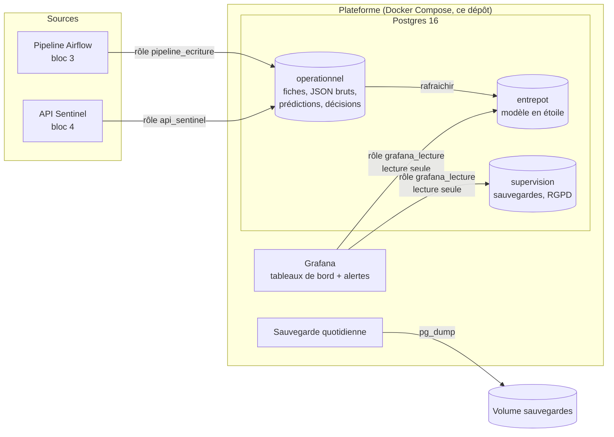
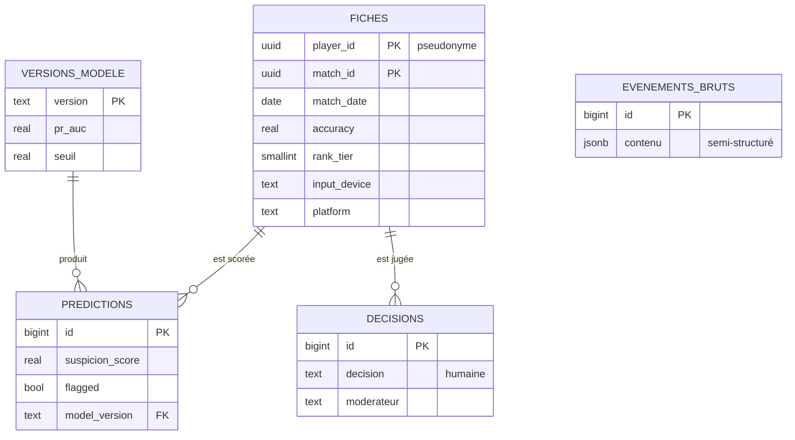

# Sentinel — Plateforme de données (bloc 2)

Infrastructure qui héberge les données de **Sentinel**, la détection de triche d'**Arena
Strike** (jeu de tir tactique 5v5 fictif du studio fictif Nebula Forge) : une base
Postgres organisée par usage, des tableaux de bord Grafana avec alertes, et des
sauvegardes automatiques testées. Tout démarre avec une commande.

> Projet réalisé pour la certification « Architecte en Intelligence Artificielle » (RNCP, niveau 7).
> Toutes les données sont synthétiques.

## Architecture



| Composant | Rôle | Choix |
|---|---|---|
| Postgres 16 | Stocke toutes les données | Gratuit, standard, gère à la fois tables classiques et JSON |
| Grafana 13 | Tableaux de bord et alertes | Gratuit, se branche directement sur Postgres, configurable par fichiers |
| Service `sauvegarde` | Une sauvegarde par jour, 7 jours gardés | Même image que la base : `pg_dump` toujours compatible |
| Docker Compose | Décrit et démarre l'ensemble | Infrastructure as code sur un seul poste ([pourquoi pas Terraform](terraform/README.md)) |

## Modèle de données

**Trois schémas, un par usage :**

| Schéma | Contenu | Qui y accède |
|---|---|---|
| `operationnel` | Données vivantes : événements bruts (JSON), fiches, versions du modèle, prédictions, décisions | Pipeline (écriture), API (lecture des fiches, écriture des prédictions et décisions) |
| `entrepot` | Modèle en étoile pour l'analyse | Grafana (lecture seule) |
| `supervision` | Sauvegardes, état de la base, registre des demandes RGPD | Grafana (sauf le registre RGPD), administrateur |

**Modèle opérationnel (relations) :**



**Entrepôt en étoile :** une table de faits au centre (`fait_fiche` : une ligne par fiche
analysée, avec son score, son signalement et la décision) et quatre dimensions autour
(`dim_date`, `dim_appareil`, `dim_rang`, `dim_modele`). Les tableaux de bord posent toujours
la même question, « combien, par jour, par appareil, par niveau, par version du modèle ? » :
l'étoile rend ces requêtes simples et rapides. L'entrepôt ne contient **aucun identifiant
de joueur** : il sert aux statistiques, pas à suivre une personne.

**Trois types de données :**

| Type | Exemple | Stockage |
|---|---|---|
| Structurées | Fiches, prédictions, décisions | Tables avec types et contraintes (bornes, valeurs autorisées) |
| Semi-structurées | Événements bruts des serveurs de jeu (JSON) | Colonne `JSONB` : la structure peut évoluer sans changer la table |
| Non structurées | Rapports HTML de dérive (bloc 4), journaux | Fichiers ; en production, un stockage objet, référencé depuis la base |

## Démarrer

Prérequis : Docker et Docker Compose.

```bash
cp .env.example .env        # remplacer chaque "change-me" (lettres et chiffres uniquement)
docker compose up -d
```

- **Grafana** : <http://localhost:3000>, identifiant `admin`, mot de passe `GRAFANA_ADMIN_PASSWORD`.
  Tableau de bord : *Dashboards → Sentinel → Sentinel — plateforme de données*.
- **Base** : `docker compose exec postgres psql -U sentinel -d sentinel`
- Au premier démarrage, la base est créée avec 30 jours de données de démonstration.
  Avec un mot de passe resté à `change-me`, la base refuse de démarrer (sécurité).

| Commande | Effet |
|---|---|
| `docker compose exec sauvegarde sh /scripts/sauvegarde.sh --une-fois` | Sauvegarde immédiate |
| `./scripts/restaurer.sh` | Restaure la dernière sauvegarde dans une base de test et compte les fiches |
| `./scripts/exporter_chiffre.sh` | Copie chiffrée (AES-256) de la dernière sauvegarde, à garder hors du serveur |
| `docker compose exec postgres psql -U sentinel -d sentinel -c "SELECT entrepot.rafraichir()"` | Met à jour l'entrepôt |
| `... -c "SELECT supervision.droit_acces('<player_id>')"` | Droit d'accès RGPD (tout sur un joueur, en JSON) |
| `... -c "SELECT supervision.droit_effacement('<player_id>')"` | Droit à l'effacement RGPD |

**Dépannage :** `docker compose ps` (état des services) et `docker compose logs <service>`.

## Supervision et alertes

Tableau de bord **Sentinel — plateforme de données** :
- fiches analysées, fiches signalées ;
- heures depuis la dernière sauvegarde (rouge au-delà de 26 h) ;
- taille de la base ;
- fiches et signalements par jour ;
- décisions des modérateurs ;
- taux de signalement par appareil et par niveau (contrôle d'équité).

| Alerte (Grafana, toutes les 5 min) | Seuil |
|---|---|
| Aucune sauvegarde depuis plus de 26 heures | Critique |
| Taux de fiches signalées anormal sur le dernier jour | > 3 % (normal ~1 %), possible dérive du modèle |

Ajouter un indicateur = ajouter un panneau dans `docker/grafana/dashboards/sentinel.json`,
versionné et relu comme le reste du code.

## Sécurité (critères 2.5, 3.2, 3.3)

| Mesure | Mise en œuvre |
|---|---|
| Secrets hors du code | Fichier `.env` non versionné ; refus de démarrer avec `change-me` |
| Moindre privilège | Un rôle par usage (`pipeline_ecriture`, `api_sentinel`, `grafana_lecture`) ; Grafana en lecture seule et sans accès aux identifiants ; fonctions RGPD réservées à l'administrateur |
| Réseau | Base et Grafana joignables uniquement depuis ce poste (`127.0.0.1`) ; pas de compte Grafana libre ni anonyme |
| Chiffrement au repos | Copies de sauvegarde chiffrées AES-256 ; en production, disque du serveur chiffré |
| Chiffrement en transit | Trafic interne au réseau Docker du poste ; en production, TLS entre services (`sslmode=require`) et HTTPS pour Grafana |
| Intégrité | Contraintes en base (bornes, valeurs autorisées, clés étrangères) |
| Référentiels | Principes ISO 27001 et recommandations de l'ANSSI : cloisonnement, moindre privilège, sauvegardes hors ligne testées, journalisation |

## RGPD (critères 3.1 et 3.5)

- **Minimisation :** identifiants pseudonymes ; pas de pseudo ni d'adresse IP (retirés par le
  pipeline) ; entrepôt sans identifiant.
- **Droits :** `supervision.droit_acces` renvoie toutes les données d'un joueur en JSON ;
  `supervision.droit_effacement` les supprime de toute la base (prédictions et décisions
  suivent automatiquement). Exception : une triche confirmée est conservée le temps de la
  contestation (article 17.3.e). Chaque demande est enregistrée dans `supervision.demandes_rgpd`.
- **Conservation :** sauvegardes 7 jours ; durées des données appliquées par le pipeline et l'API.
- **Secteur :** le jeu vidéo n'est pas un secteur réglementé (critère 3.4) ; seule la présence
  de mineurs (PEGI 16) impose des précautions, traitées dans la gouvernance (bloc 1).

## Fiabilité, volume et évolution (critères 1.x et 2.x)

| Besoin | Réponse aujourd'hui | En production |
|---|---|---|
| Volume : 30 000 fiches par jour, environ 11 millions par an | Postgres sur un poste : 45 000 fiches occupent 27 Mo, donc environ 7 Go par an | Partitionnement des tables par mois |
| Vitesse : une fiche toutes les 3 secondes en moyenne | Largement absorbé (le pipeline insère 6 000 lignes par seconde) | — |
| Variété | Tables + JSONB + fichiers | Stockage objet pour les fichiers |
| Sauvegardes | Quotidiennes, 7 jours, restauration testée par la CI, copie chiffrée hors serveur | Sauvegarde continue (archivage des journaux de transactions) |
| Continuité en cas de panne | Redémarrage automatique des services ; restauration en quelques minutes | Réplique Postgres en lecture et basculement automatique |
| Montée en charge | Limites de ressources par service, ajustables | Base managée ou serveur plus puissant ; Grafana derrière un répartiteur |

**Limite assumée :** un seul serveur, donc pas de haute disponibilité. Pour un service
de modération qui tolère quelques minutes d'interruption, sauvegardes testées et redémarrage
automatique suffisent ; la réplication est la prochaine étape si le besoin évolue.

## Intégration continue

À chaque modification, GitHub démarre toute la plateforme et vérifie :
- la base (données, entrepôt, droits RGPD) ;
- l'absence d'accès de Grafana aux identifiants ;
- Grafana (source de données, tableau de bord, alertes, requête réelle) ;
- la sauvegarde, puis sa restauration dans une base de test.

## Structure du dépôt

| Dossier | Contenu |
|---|---|
| `docker/postgres/init/` | `01_roles.sh` (rôles), `02_schema.sql` (modèle de données, RGPD, supervision), `03_droits.sql` (droits), `04_demo.sql` (données de démonstration) |
| `docker/grafana/` | Source de données, tableau de bord et alertes, en fichiers |
| `scripts/` | Sauvegarde, restauration, export chiffré |
| `terraform/` | Justification du choix de Docker Compose |
| `.github/workflows/` | Déploiement et vérifications automatiques |

## Usage de l'IA générative

Un assistant IA (Claude) a été utilisé pour l'accompagnement et la préparation de fichiers.
Les commits concernés portent la mention `Co-Authored-By: Claude`. Chaque choix a été relu,
compris et validé par l'auteur.
